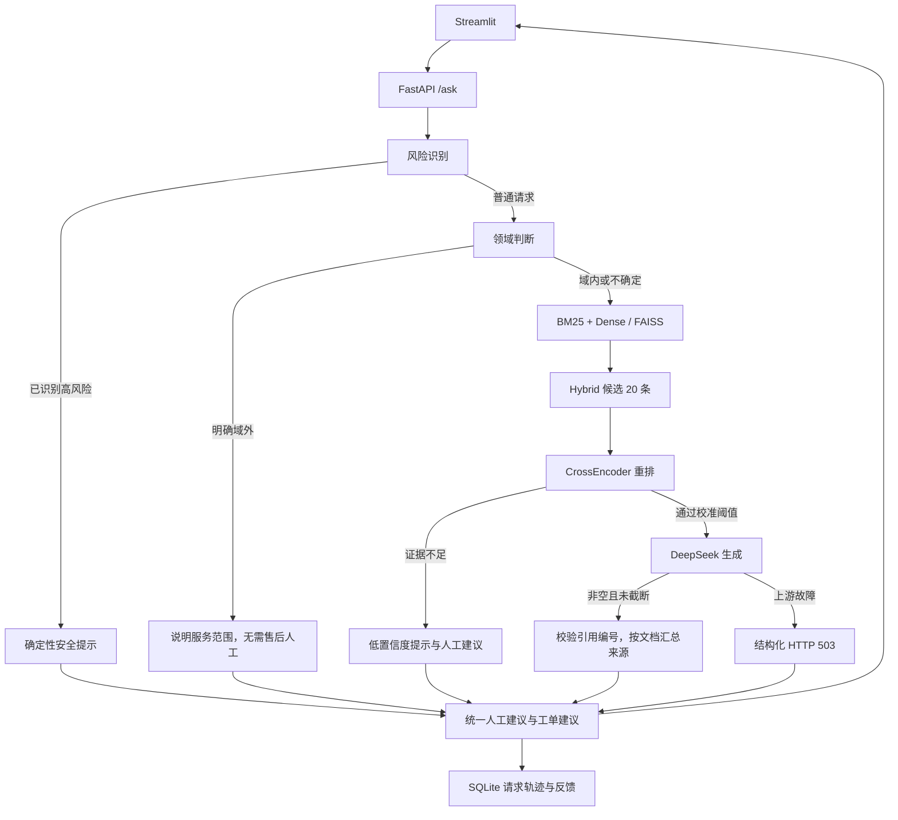

# 系统架构（2026-10-31）

知识库为 24 篇模拟文档、103 个切片。向量模型为固定 revision 的 bge-small-zh-v1.5；重排序模型及阈值从 `configs/deployment.json` 读取，环境变量可覆盖。CUDA 使用 FP16、CPU 使用 FP32。Hybrid 的 BM25 权重固定为 0.3，本轮未重新搜索。

`need_human` 为最终路由，响应、工单建议、日志与页面共同使用。风险内部信号不等于最终路由。工单状态为建议，没有实际派单或承诺退款权限。

生成适配层最多尝试两次，关闭 SDK 内置重试；记录错误类别、finish_reason、token、模型和耗时。HTTP 操作超时与剩余预算检查不能保证严格的墙钟时间上限。故障不伪装成成功回答。

引用以切片编号定位，来源列表按文档归并并保留章节。编号有效不等于语义支持正确。高风险模板注明其为安全规则，不伪造检索来源。

索引清单校验语料 SHA256、模型 revision、维度与数量，失配时重建。SQLite 追加字段迁移，不删除旧反馈。`/health` 检查存活，`/ready` 检查就绪，不调用付费模型。

局限：风险和领域判断主要依赖规则，开放表达仍可能漏检。项目没有真实企业数据、生产 SLA 或完整工单系统。
