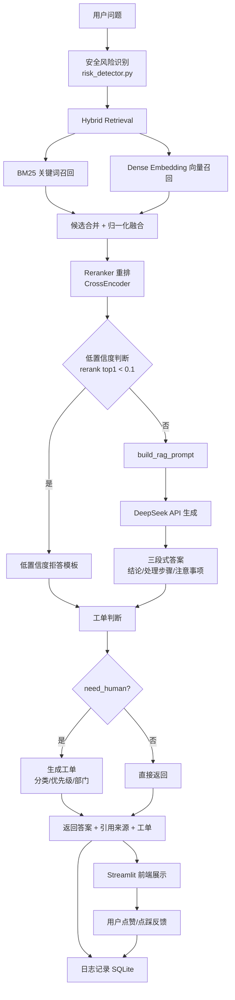

# 系统架构图

## 模块与代码对应关系

| 架构环节 | 对应代码 |
|---|---|
| 安全风险识别 | `app/safety/risk_detector.py`、`app/safety/policy.py`、`app/safety/refusal.py` |
| BM25 召回 | `app/retrieval/bm25_retriever.py` |
| Dense 召回 | `app/retrieval/dense_retriever.py`（FAISS 持久化索引） |
| Hybrid 融合 | `app/retrieval/hybrid_retriever.py`（`bm25_weight` 可调） |
| Reranker 重排 | `app/retrieval/reranker.py`（CrossEncoder） |
| Prompt 构造 | `app/generation/prompt.py` |
| LLM 生成 | `app/generation/llm_client.py`（DeepSeek API + 降级兜底） |
| 工单判断与生成 | `app/ticket/classifier.py`、`app/ticket/ticket_builder.py` |
| 主流程串联 | `app/main_pipeline.py`（`CustomerSupportRAG.answer`） |
| FastAPI 后端 | `app/main.py`（`/ask`、`/feedback`、`/health`） |
| 日志与反馈存储 | `app/storage/db.py`（SQLite：`query_logs`、`feedback`） |
| Streamlit 前端 | `frontend/streamlit_app.py` |
| 离线评估 | `app/evaluation/`、`scripts/run_eval.py` |
